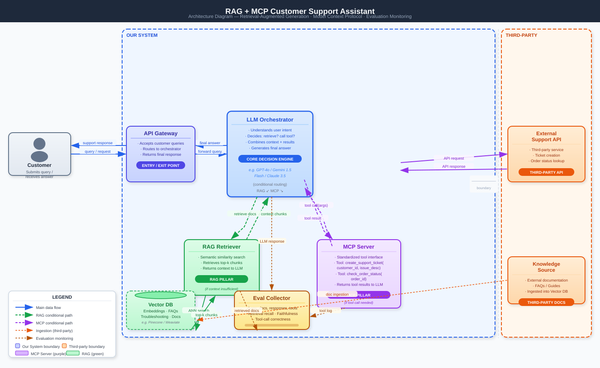

# RAG + MCP Customer Support Assistant

> **A professional GenAI architecture reference design combining Retrieval-Augmented Generation (RAG) and Model Context Protocol (MCP) for an intelligent, grounded, and tool-capable customer support system.**

---

## Table of Contents

1. [Project Overview](#project-overview)
2. [Problem Statement](#problem-statement)
3. [System Architecture](#system-architecture)
4. [RAG Pillar](#rag-pillar)
5. [MCP Pillar](#mcp-pillar)
6. [Component Descriptions](#component-descriptions)
7. [End-to-End Data Flow](#end-to-end-data-flow)
8. [System Boundary](#system-boundary)
9. [Eval Collector](#eval-collector)
10. [Evaluation Metrics](#evaluation-metrics)
11. [Architecture Trade-offs](#architecture-trade-offs)
12. [Why No Autonomous Agent](#why-no-autonomous-agent)

---

## Project Overview

This project presents a **production-grade architecture design** for a GenAI-powered customer support assistant. The assistant can:

- Answer customer questions using **grounded, up-to-date support documentation** (via RAG).
- Execute **support operations** such as creating tickets and checking order status (via MCP).
- **Collect evaluation data** to continuously measure system quality, retrieval accuracy, and tool reliability.

The design is intentionally minimal — covering exactly what is needed to handle real customer support interactions without over-engineering or introducing unnecessary components.

---

## Problem Statement

Traditional rule-based customer support bots fail when queries go outside their scripted decision trees. LLMs alone hallucinate when asked about proprietary product information they were not trained on. Integrating LLMs with live support systems (ticket creation, order lookup) requires safe, structured tool calling.

**This architecture solves three problems:**

| Problem | Solution |
|---------|----------|
| LLM hallucination on support-specific content | RAG retrieval from a curated vector knowledge base |
| Inability to perform real support actions | MCP-standardised tool calls to external APIs |
| No visibility into system quality | Eval Collector capturing per-request metrics |

---

## System Architecture

The diagram below shows the complete system architecture including data flows, system boundaries, and evaluation monitoring paths.



### Architecture at a Glance

```
                        ┌─────────────────── OUR SYSTEM ────────────────────┐
Customer ──► API Gateway ──► LLM Orchestrator ──► RAG Retriever ──► Vector DB
                                    │                    ▲
                                    │   (context chunks) │
                                    │                    │
                                    ▼
                              MCP Server ──► External Support API  (THIRD-PARTY)
                                    │
                            ┌───────────────┐
                            │ Eval Collector │  ◄── RAG + LLM + MCP signals
                            └───────────────┘
                        └────────────────────────────────────────────────────┘
```

---

## RAG Pillar

**Retrieval-Augmented Generation (RAG)** improves answer grounding by supplying the LLM with relevant, verified content at inference time — without requiring model retraining.

### How It Works

1. **Ingestion (offline):** Support documents (FAQs, troubleshooting guides, product manuals) are chunked, embedded using a text embedding model, and stored in a Vector Database.
2. **Retrieval (online, conditional):** When the LLM Orchestrator determines that the user's question requires factual support knowledge, it calls the RAG Retriever.
3. **Semantic Search:** The retriever embeds the user query and performs an Approximate Nearest Neighbour (ANN) search in the vector index to find the most semantically similar document chunks.
4. **Context Injection:** The top-k retrieved chunks are appended to the LLM's prompt as grounding context.
5. **Grounded Generation:** The LLM generates an answer based on the retrieved content, reducing hallucination.

### RAG Benefits

- Answers stay faithful to official support documentation.
- Knowledge can be updated by re-indexing without retraining the LLM.
- Sources can be cited in the response (transparency).

### RAG Cost

- Adds retrieval latency (~100–300 ms per request).
- Requires maintaining an embedding pipeline and vector database.

---

## MCP Pillar

**Model Context Protocol (MCP)** provides a standardised, LLM-agnostic interface for exposing external operations as well-typed, callable tools. It acts as a stable contract between the LLM and the external world.

### How It Works

1. **Tool Definition:** The MCP Server defines tools with explicit names, parameter schemas, and descriptions.
2. **Tool Selection (conditional):** When the LLM Orchestrator determines a support action is needed, it emits a structured function call referencing the tool name and arguments.
3. **Dispatch:** The MCP Server receives the call, validates arguments, and forwards the request to the External Support API.
4. **Result Return:** The API response is returned to the MCP Server, structured as a JSON result, and passed back to the LLM Orchestrator for synthesis into the final answer.

### Defined MCP Tools

```json
{
  "tools": [
    {
      "name": "create_support_ticket",
      "description": "Opens a new support ticket for a customer.",
      "parameters": {
        "customer_id": "string (required)",
        "issue_description": "string (required)"
      }
    },
    {
      "name": "check_order_status",
      "description": "Returns the current fulfilment status of an order.",
      "parameters": {
        "order_id": "string (required)"
      }
    }
  ]
}
```

### MCP Benefits

- **Reusability:** The same tool definitions are usable by any LLM client without re-engineering.
- **Isolation:** External API credentials never appear in the LLM's context window.
- **Versioning:** Tool contracts can be versioned independently of the LLM model.

### MCP Cost

- Requires maintaining a running MCP Server and keeping tool schemas up to date.
- Adds one network round-trip per tool call (~200–600 ms).

---

## Component Descriptions

### A — Customer / User
The external actor who submits a natural-language support question via a web chat, mobile app, or API client. Receives the final answer from the API Gateway. Never communicates directly with any internal service.

### B — API Gateway
The single entry and exit point for all customer traffic. Responsibilities include TLS termination, authentication, rate limiting, request routing, and response serialisation. Decouples internal services from the public interface.

### C — LLM Orchestrator
The core decision engine. It interprets the user's query, decides whether retrieval (RAG) or a tool call (MCP) is needed, combines all available context, and generates the final answer. Runs a large language model such as GPT-4o, Gemini 1.5 Flash, or Claude 3.5 Sonnet.

### D — RAG Retriever
Performs semantic similarity search against the Vector Database. Receives the user query, embeds it, finds the top-k most relevant document chunks, and passes them back to the LLM Orchestrator as grounding context. Only activated when the LLM determines retrieval is necessary.

### E — Vector Database
Stores pre-computed embeddings of all support content. Contains FAQs, troubleshooting guides, and product documentation. Serves top-k matching chunks to the RAG Retriever on query. Technology options include Pinecone, Weaviate, Qdrant, Chroma, or pgvector.

### F — MCP Server
Exposes external support operations as standardised MCP tools. Receives structured function calls from the LLM Orchestrator, validates arguments, calls the External Support API, and returns structured results. Tool inventory: `create_support_ticket`, `check_order_status`.

### G — External Support API *(Third-Party)*
A third-party service (e.g. Zendesk, Salesforce, Shopify) that processes ticket creation and order status queries. Called exclusively through the MCP Server. Not part of our system boundary.

### H — Knowledge Source *(Third-Party)*
External repository of support documentation (e.g. a CMS, S3 bucket, or documentation portal). Content is ingested offline into the Vector Database. Not part of our system boundary.

### I — Eval Collector
A passive monitoring component that records per-request evaluation data: retrieved document chunks, the LLM-generated response, and MCP tool calls and their results. Powers offline evaluation pipelines for continuous quality measurement.

---

## End-to-End Data Flow

### Step-by-Step Request Lifecycle

```
1.  Customer          ──[ HTTPS query ]──────────────────────► API Gateway
2.  API Gateway       ──[ forward query ]───────────────────► LLM Orchestrator
3a. LLM Orchestrator  ──[ retrieve docs? ]──────────────────► RAG Retriever
4.  RAG Retriever     ──[ ANN vector search ]───────────────► Vector Database
5.  Vector Database   ──[ top-k chunks ]──────────────────► RAG Retriever
6.  RAG Retriever     ──[ context chunks ]────────────────► LLM Orchestrator
3b. LLM Orchestrator  ──[ tool call needed? ]──────────────► MCP Server
7.  MCP Server        ──[ API request ]───────────────────► External Support API
8.  External API      ──[ API response ]───────────────────► MCP Server
9.  MCP Server        ──[ tool result ]──────────────────► LLM Orchestrator
10. LLM Orchestrator  ──[ final answer ]───────────────────► API Gateway
11. API Gateway       ──[ support response ]────────────────► Customer

Monitoring (async, out-of-band):
    RAG Retriever     ──[ retrieved docs ]─────────────────► Eval Collector
    LLM Orchestrator  ──[ LLM response ]───────────────────► Eval Collector
    MCP Server        ──[ tool log ]───────────────────────► Eval Collector
```

> **Steps 3a and 3b are conditional** — they execute only when the LLM Orchestrator determines retrieval or tool calling is necessary.

---

## System Boundary

The architecture is divided into two ownership zones:

### Our System
Components we build, deploy, monitor, and are accountable for:

| Component          | Responsibility                                |
|--------------------|-----------------------------------------------|
| API Gateway        | Public interface, auth, rate limiting         |
| LLM Orchestrator   | Intent classification, routing, generation    |
| RAG Retriever      | Semantic search, chunk retrieval              |
| Vector Database    | Embedding storage and ANN indexing            |
| MCP Server         | Tool definitions, API dispatch, result return |
| Eval Collector     | Evaluation logging and metric collection      |

### Third-Party Systems
External services we consume but do not control:

| Component             | Role                                            |
|-----------------------|-------------------------------------------------|
| External Support API  | Ticket management, order fulfilment operations  |
| Knowledge Source      | Provides documentation for index ingestion      |

**Security note:** Third-party API credentials are stored securely within Our System (MCP Server secrets manager) and are never passed to the LLM or the customer.

---

## Eval Collector

The **Eval Collector** is a dedicated observability component that passively captures evaluation signals during each request cycle.

### What It Collects

| Signal Source    | Data Collected                                              |
|------------------|-------------------------------------------------------------|
| RAG Retriever    | Retrieved document chunks and their similarity scores       |
| LLM Orchestrator | The final generated response and the full prompt context    |
| MCP Server       | Tool name called, arguments supplied, result returned       |

### How It Works

- Receives data via **asynchronous, fire-and-forget writes** so it never adds latency to the user-facing response path.
- Stores records as append-only JSONL logs or in a time-series/analytical store (e.g. BigQuery, Postgres).
- Powers offline evaluation scripts that compute quality metrics.

### Sample Record

```jsonc
{
  "request_id": "b7f3e2a1-...",
  "timestamp": "2026-11-15T17:05:00Z",
  "user_query": "What is the return policy for defective items?",
  "retrieved_chunks": [
    { "text": "Items can be returned within 30 days...", "source": "returns_policy.md", "score": 0.94 }
  ],
  "llm_response": "You can return defective items within 30 days of purchase...",
  "tool_calls": [],
  "latency_ms": { "retrieval": 142, "llm": 1105 }
}
```

---

## Evaluation Metrics

| Metric                 | Description                                                              | Powered By                        |
|------------------------|--------------------------------------------------------------------------|-----------------------------------|
| **Retrieval Recall**   | Were the gold-standard relevant chunks retrieved?                        | Retrieved chunks vs. ground truth |
| **Answer Faithfulness**| Does the response stay within the retrieved context (no hallucination)?  | LLM response + retrieved chunks   |
| **Tool-Call Correctness**| Were the right tools called with valid, correctly-typed arguments?     | Tool logs from MCP Server         |
| **End-to-End Latency** | Total time from query receipt to response delivery                       | Gateway timestamps                |
| **Retrieval Precision**| Fraction of retrieved chunks that are actually relevant                  | Retrieved chunks vs. ground truth |

Evaluation is run **offline** against the data collected by the Eval Collector — not in the live request path.

---

## Architecture Trade-offs

### 1. RAG: Factual Grounding vs. Infrastructure Complexity

| ✅ Benefit | ⚠️ Cost |
|------------|---------|
| Reduces LLM hallucination significantly | Adds retrieval latency (100–300 ms) |
| Knowledge updates without LLM retraining | Requires embedding pipeline + vector DB |
| Enables source citation and transparency | Chunk quality affects answer quality |

**Recommendation:** Accept this trade-off. The grounding benefit far outweighs the latency and infrastructure overhead for a support assistant where factual accuracy is critical.

### 2. MCP: Reusable Tool Integration vs. Server Maintenance

| ✅ Benefit | ⚠️ Cost |
|------------|---------|
| LLM-agnostic, versioned tool contracts | Requires maintaining MCP Server |
| External credentials stay isolated | Tool schemas must be kept in sync with APIs |
| Reusable across multiple LLM clients | Adds tool call round-trip latency (200–600 ms) |

**Recommendation:** Accept this trade-off. MCP's standardisation benefits outweigh maintenance costs, especially when the same tools may serve future LLM applications.

### 3. Eval Collector: Observability vs. Logging Overhead

| ✅ Benefit | ⚠️ Cost |
|------------|---------|
| Enables continuous quality monitoring | Adds async logging overhead |
| Supports regression detection | Requires evaluation storage infrastructure |
| Closes the feedback loop for improvement | PII in logs requires careful data governance |

**Recommendation:** Use async (fire-and-forget) writes. The observability value is essential for a production system; the overhead is minimal if implemented correctly.

---

## Why No Autonomous Agent

An **autonomous agent** (plan → act → observe → repeat loop) was **intentionally excluded** from this architecture.

### Reasoning

| Consideration | Decision |
|---------------|----------|
| This use case requires only **single-step** conditional retrieval | An agent loop adds unnecessary non-determinism |
| This use case requires only **specific, pre-defined** tool calls | An agent would over-engineer the solution |
| Autonomous agents are harder to debug and monitor | The LLM Orchestrator is already deterministically routing |
| Agent loops increase latency significantly | A single orchestration cycle is sufficient |

**The LLM Orchestrator already performs all necessary decision-making:**
- It classifies intent.
- It decides whether to retrieve.
- It decides which tool (if any) to call.
- It synthesises the final answer.

No iterative planning cycle is needed. Adding an autonomous agent would introduce complexity, latency, and unpredictability without adding capability for this specific use case.

> **Principle applied:** *Use the simplest architecture that fully meets the requirements.*

---

## Project Structure

```
RAG-MCP-Customer-Support-Architecture/
│
├── README.md                                        ← This file
├── architecture/
│   └── rag_mcp_customer_support_architecture.svg   ← Architecture diagram (editable SVG)
└── docs/
    └── architecture-notes.md                       ← Detailed component notes
```

---

## Getting Started

This repository is a **documentation and architecture design project**. There is no application code to run.

To use this design:

1. **Clone or fork** this repository.
2. **Open the SVG** in any vector editor (Inkscape, Figma, draw.io, Adobe Illustrator) for editing.
3. **Read the README** for the full architecture rationale.
4. **Read `docs/architecture-notes.md`** for deeper implementation guidance on each component.

---

## License

This project is released for educational and portfolio use. Feel free to adapt the architecture for your own projects.

---

*RAG + MCP Customer Support Assistant — Architecture Design*  
*Version 1.0 — November 2026*
